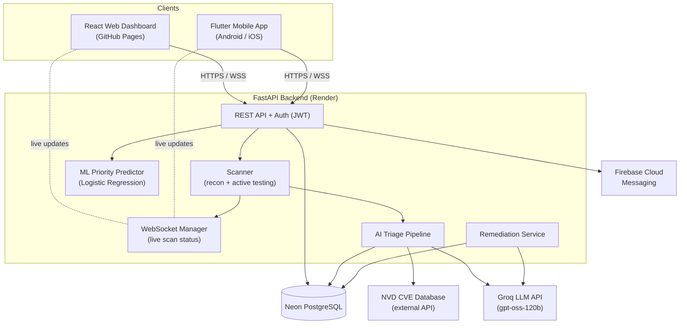
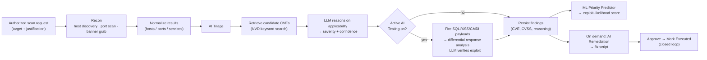
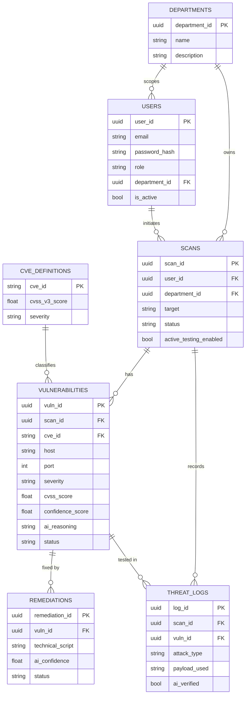
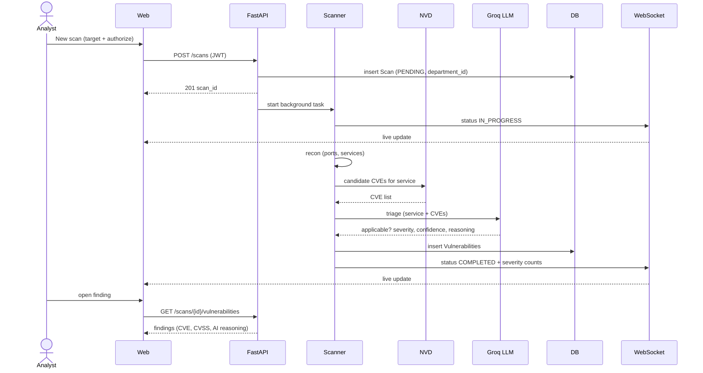
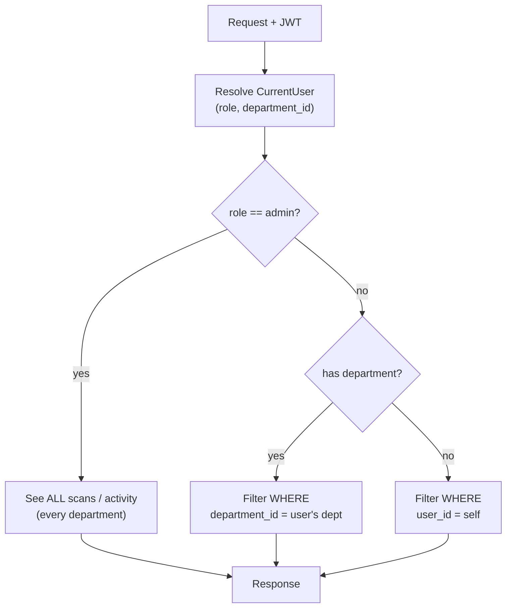

# Vulnara — System Diagrams

Diagrams for the project report. They are written in **Mermaid**, which renders
automatically on GitHub and in most Markdown tools (VS Code with the Mermaid
extension, Typora, Obsidian, HackMD). To export an image, paste a block into
<https://mermaid.live> and download the SVG/PNG.

---

## 1. System Architecture

---

## 2. Scan Data-Flow Pipeline

---

## 3. Entity-Relationship (Database)

---

## 4. Sequence — A Scan from Start to Finding

---

## 5. RBAC & Department Scoping

---

## 6. Machine-Learning Pipeline (Priority Predictor)

```mermaid
flowchart LR
    DG["Dataset generator<br/>(documented domain labels + noise)"] --> DS["dataset.csv<br/>(9 features, 5000 rows)"]
    DS --> SPLIT["Stratified 75/25 split<br/>+ 5-fold CV"]
    SPLIT --> TRAIN["Train & compare:<br/>LogReg · DecisionTree · RandomForest"]
    TRAIN --> EVAL["Evaluate<br/>accuracy · precision · recall · F1 · ROC-AUC"]
    EVAL --> PICK["Select Logistic Regression<br/>(best F1, interpretable)"]
    PICK --> EXP["Export weights →<br/>app/ml/model_params.json"]
    EXP --> INF["Runtime inference (pure numpy)<br/>sigmoid((x-μ)/σ · w + b)"]
    INF --> EP["API: /ml/risk-score,<br/>/scans/{id}/risk"]
```

